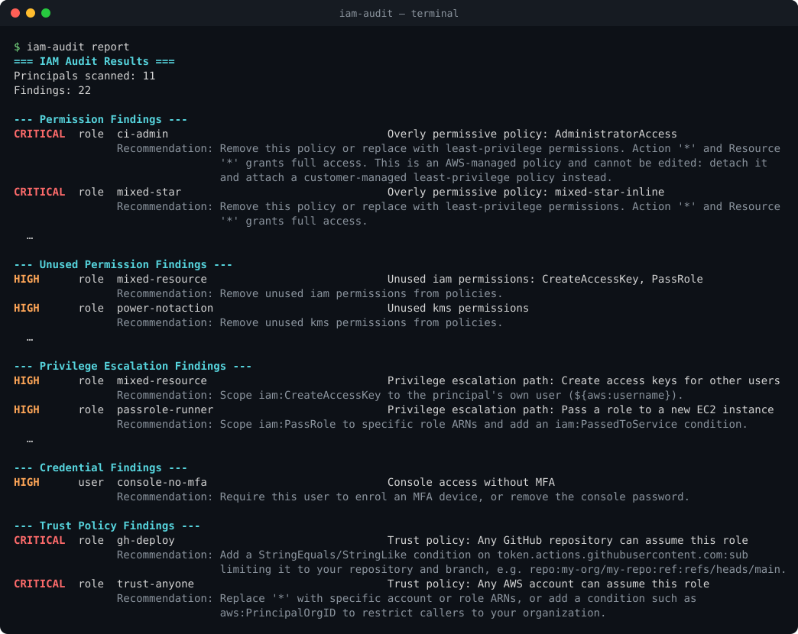
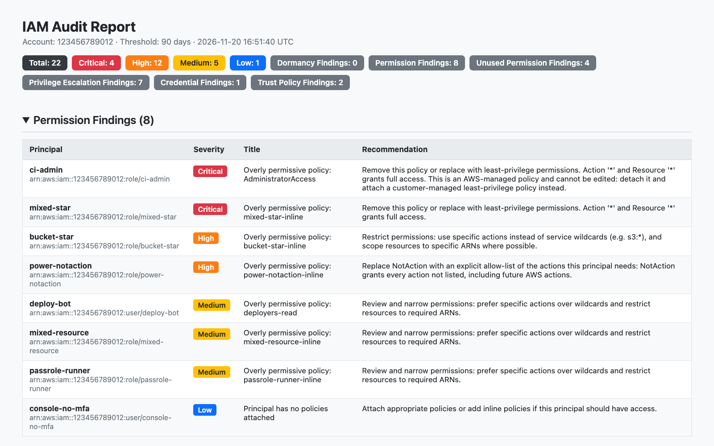

# iam-audit

[](https://github.com/rshahar1/iam-permissions-cutoff/actions/workflows/ci.yml)
[](LICENSE)

A CLI tool to audit AWS IAM roles and users for over-provisioning. It identifies dormant principals, overly permissive policies, and unused permissions — helping teams achieve a least-privilege security posture without manual AWS console work.

## Features

- **Dormancy detection** — flags roles and users with no activity beyond a configurable threshold (default: 90 days), including entities that have never been used (new principals get a grace period equal to the threshold, measured from creation)
- **Permission analysis** — detects wildcard actions (`*`), wildcard resources (`*`), and broad service-level wildcards (e.g., `s3:*`) across inline, managed, and group policies. Notes the presence of Deny statements that may restrict effective permissions
- **Unused permission analysis** — uses AWS Access Advisor (action-level granularity) to identify granted permissions that have never been exercised, with wildcard expansion via a bundled IAM actions map
- **Consolidated reporting** — combines all findings into a single report in text (table), JSON, or **HTML** format
- **HTML reports** — self-contained, static HTML files with collapsible category sections, severity color-coding, summary badges, and print-friendly styling. No JavaScript required
- **Scoped audits** — filter by IAM path prefix, name glob pattern, or resource tags (AND-combined)
- **Safe by design** — read-only; audits and recommends, never modifies AWS resources
- **CI/CD-friendly** — distinct exit codes and JSON output for pipeline integration
- **Deterministic output** — findings are sorted by severity (Critical → Low), then alphabetically by principal name

## Requirements

- Python 3.12+
- AWS credentials configured via the standard credential chain (environment variables, `~/.aws/credentials`, SSO, or instance profile)
- IAM read permissions (see [Required AWS Permissions](#required-aws-permissions))

## Installation

```bash
python3 -m venv .venv
source .venv/bin/activate
pip install -e .
```

For development (dev tools plus the package in editable mode, as CI does):

```bash
pip install -r requirements-dev.txt -e .
```

## Required AWS Permissions

The caller needs the following IAM permissions. The tool validates these before starting and reports any that are missing:

```
iam:ListRoles
iam:GetRole
iam:ListUsers
iam:ListAccessKeys
iam:GetAccessKeyLastUsed
iam:ListGroupsForUser
iam:ListAttachedRolePolicies
iam:ListAttachedUserPolicies
iam:ListRolePolicies
iam:ListUserPolicies
iam:GetRolePolicy
iam:GetUserPolicy
iam:GetPolicy
iam:GetPolicyVersion
iam:ListRoleTags
iam:GenerateServiceLastAccessedDetails
iam:GetServiceLastAccessedDetails
sts:GetCallerIdentity
```

The credential checks (`credentials` subcommand and `report`) additionally need `iam:GenerateCredentialReport` and `iam:GetCredentialReport`. If they are denied, the audit continues and records a data gap instead of credential findings.

The tool is entirely read-only and requires no write permissions.

## Usage

```
iam-audit <subcommand> [options]
```

### Subcommands

| Subcommand    | Description                                                        |
|---------------|--------------------------------------------------------------------|
| `dormancy`    | Identify principals with no recent activity                        |
| `permissions` | Detect overly permissive policies and unused permission grants     |
| `credentials` | Audit root, MFA, access key and password hygiene                   |
| `report`      | Generate a consolidated audit report (all checks)                  |

### Options

| Option                  | Default | Description                                                |
|-------------------------|---------|------------------------------------------------------------|
| `--days N`              | `90`    | Dormancy threshold and Access Advisor lookback window      |
| `--path-prefix PREFIX`  | —       | Filter principals by IAM path prefix                       |
| `--name PATTERN`        | —       | Filter principals by name glob pattern (e.g., `ci-*`)     |
| `--tag KEY=VALUE`       | —       | Filter by tag; repeatable for multiple tags (AND-combined) |
| `--include-aws-managed` | off     | Also scan service-linked, service, and IAM Identity Center (`/aws-reserved/`) roles. AWS-managed policies attached to your own principals are always analyzed |
| `--format text\|json\|html` | `text` | Output format                                          |
| `--output PATH`         | —       | Write output to file instead of stdout (required for HTML) |
| `--concurrency N`       | `10`    | Max concurrent Access Advisor API requests                 |
| `--key-max-age N`       | `90`    | Flag active access keys not rotated in N days (credential checks) |
| `--trusted-accounts IDS` | —      | Comma-separated 12-digit account IDs whose role trust is expected (trust checks); repeatable |
| `--version`             |         | Show version and exit                                      |

### Examples

```bash
# Find dormant roles and users (90-day default)
iam-audit dormancy

# Custom threshold (30 days)
iam-audit dormancy --days 30

# Scan for overly permissive policies and unused permissions
iam-audit permissions

# Full consolidated report
iam-audit report

# JSON output for automation pipelines
iam-audit report --format json > audit-results.json

# HTML report (standalone shareable file)
iam-audit report --format html --output audit-report.html

# HTML works on all subcommands
iam-audit dormancy --format html --output dormancy.html
iam-audit permissions --format html --output permissions.html

# Scope to a specific team
iam-audit report --path-prefix /team-alpha/
iam-audit report --tag team=platform
iam-audit report --name "ci-*"

# Also scan AWS-managed roles (service-linked, service, and SSO /aws-reserved/ roles)
iam-audit report --include-aws-managed

# Write any format to a file
iam-audit report --format json --output audit.json
iam-audit report --format text --output audit.txt
```

## Output Formats

> The examples below come from a fictional account (placeholder ID `123456789012`) seeded into the local
> [moto](https://github.com/getmoto/moto) emulator used by the [smoke test](#local-emulator-smoke-test).
> moto does not implement Access Advisor, so the last-accessed data behind the *Unused Permission* findings
> is simulated; every finding is real output of the analyzers. The complete sample reports are in
> [`examples/`](examples/).

### Text

Human-readable output grouped by finding category, with color-coded severities and a recommendation for
every finding. Excerpt (first findings of each category):



Full sample: [`examples/report.txt`](examples/report.txt)

### JSON

Machine-readable output following a versioned schema (`schema_version: "1.0.0"`). Findings are sorted by severity descending, then by principal name. See [specs/003-iam-audit-cli/contracts/json-schema.md](specs/003-iam-audit-cli/contracts/json-schema.md) for the full schema reference, and the `contracts/json-schema-delta.md` file of each later feature in [`specs/`](specs/) for the categories added since.

```json
{
  "schema_version": "1.0.0",
  "account_id": "123456789012",
  "audit_timestamp": "2026-11-20T16:51:40.637163Z",
  "threshold_days": 90,
  "include_aws_managed": false,
  "filters": { "path_prefix": null, "name_pattern": null, "tags": null },
  "summary": {
    "total_findings": 22,
    "principals_scanned": 11,
    "data_gaps_count": 0,
    "by_category": {
      "permission": 8, "unused_permission": 4, "privilege_escalation": 7,
      "credential": 1, "trust_policy": 2
    },
    "by_severity": { "critical": 4, "high": 12, "medium": 5, "low": 1 }
  },
  "findings": [ "..." ],
  "data_gaps": []
}
```

Full sample: [`examples/report.json`](examples/report.json)

### HTML

Self-contained static HTML file with:
- Summary badges showing total findings and severity breakdown
- Collapsible `<details>`/`<summary>` sections per finding category (collapsed by default)
- Severity color-coding (Critical: red, High: orange, Medium: yellow, Low: blue)
- Print-friendly — `@media print` forces all sections expanded
- No JavaScript — works in any browser, safe to share as a standalone file
- All dynamic content escaped via `html.escape()` to prevent XSS

[](docs/images/report-html-full.png)

*Click the screenshot for the full report with every section expanded.* Full sample:
[`examples/report.html`](examples/report.html) (download and open it in a browser).

## Exit Codes

| Code | Meaning                                                         |
|------|-----------------------------------------------------------------|
| `0`  | Audit complete — no findings                                    |
| `1`  | Audit complete — findings present                               |
| `2`  | Tool error (credentials, permissions, invalid arguments)        |

### Privilege-escalation checks

The `permissions` and `report` subcommands also flag principals whose effective policies (managed, inline and group) let them escalate their own privileges. A rule fires only when **all** of its required actions are granted by an `Allow` statement that applies to all resources (`"*"` in `Resource`, or any `NotResource`), through `Action` patterns (wildcards included) or `NotAction`. An unconditional `Deny` listing `"*"` as a resource suppresses the matching actions. Principals with full admin access are skipped because they are already reported as `CRITICAL` permission findings. Findings use the category `privilege_escalation`.

| Rule | Severity | Required actions |
|------|----------|------------------|
| `PE-001` | CRITICAL | `iam:CreatePolicyVersion` |
| `PE-002` | HIGH | `iam:SetDefaultPolicyVersion` |
| `PE-003` | CRITICAL | `iam:AttachUserPolicy` |
| `PE-004` | CRITICAL | `iam:AttachGroupPolicy` |
| `PE-005` | CRITICAL | `iam:AttachRolePolicy` |
| `PE-006` | CRITICAL | `iam:PutUserPolicy` |
| `PE-007` | CRITICAL | `iam:PutGroupPolicy` |
| `PE-008` | CRITICAL | `iam:PutRolePolicy` |
| `PE-009` | HIGH | `iam:AddUserToGroup` |
| `PE-010` | CRITICAL | `iam:UpdateAssumeRolePolicy` |
| `PE-011` | HIGH | `iam:CreateAccessKey` |
| `PE-012` | HIGH | `iam:CreateLoginProfile` |
| `PE-013` | HIGH | `iam:UpdateLoginProfile` |
| `PE-014` | HIGH | `iam:PassRole` + `ec2:RunInstances` |
| `PE-015` | HIGH | `iam:PassRole` + `lambda:CreateFunction` |
| `PE-016` | HIGH | `lambda:UpdateFunctionCode` |
| `PE-017` | HIGH | `iam:PassRole` + `cloudformation:CreateStack` |
| `PE-018` | HIGH | `iam:PassRole` + `codebuild:CreateProject` |
| `PE-019` | HIGH | `iam:PassRole` + `ecs:RegisterTaskDefinition` + `ecs:RunTask` |
| `PE-020` | HIGH | `iam:PassRole` + `glue:CreateDevEndpoint` |
| `PE-021` | HIGH | `glue:UpdateDevEndpoint` |
| `PE-022` | HIGH | `ssm:SendCommand` |
| `PE-023` | HIGH | `ssm:StartSession` |
| `PE-024` | MEDIUM | `sts:AssumeRole` |

**Limitation:** only grants on all resources are evaluated. Grants scoped to specific resources (for example `iam:PassRole` on one role ARN) are intentionally ignored to avoid noise, and permission boundaries, SCPs and conditions on `Allow` statements are not evaluated.

### Credential checks

The `credentials` subcommand (also part of `report`) reads the IAM credential report and emits `credential` findings. It needs `iam:GenerateCredentialReport` and `iam:GetCredentialReport`. The report covers users that pass your filters; the root account is included only when no `--path-prefix`, `--name` or `--tag` filter is set.

| Rule       | Severity | Condition |
|------------|----------|-----------|
| `CRED-001` | CRITICAL | Root account has an active access key |
| `CRED-002` | CRITICAL | Root account has no MFA device |
| `CRED-003` | MEDIUM   | Root password used within the last `--days` days |
| `CRED-004` | HIGH     | User has a console password but no MFA |
| `CRED-005` | MEDIUM   | Active access key not rotated within `--key-max-age` days (default 90) |
| `CRED-006` | MEDIUM   | Active access key never used and older than `--days` days |
| `CRED-007` | LOW      | User has two active access keys |
| `CRED-008` | MEDIUM   | Console password never used and user older than `--days` days |

Per-key rules produce one finding per key (`key_slot` 1 or 2 in the metadata).

```bash
iam-audit credentials
iam-audit credentials --key-max-age 60
```

### Trust policy checks

The `permissions` and `report` subcommands also inspect each role's trust policy (`AssumeRolePolicyDocument`, already returned by `ListRoles`, so no extra API calls). Only `Allow` statements that grant `sts:AssumeRole`, `sts:AssumeRoleWithWebIdentity`, `sts:AssumeRoleWithSAML` (or `sts:*` / `*`) are examined, and service-linked and `/aws-reserved/` roles are skipped. One finding is emitted per statement per rule (category `trust_policy`).

| Rule | Severity | Detects |
|------|----------|---------|
| `TRUST-001` | CRITICAL | Principal `*` (any AWS account) with no `aws:PrincipalOrgID`, `aws:PrincipalOrgPaths`, `aws:PrincipalAccount`, `aws:PrincipalArn`, `aws:SourceAccount`, `aws:SourceArn` or `aws:SourceOrgID` condition |
| `TRUST-002` | HIGH | `Allow` with `NotPrincipal` (trusts everyone except those listed) |
| `TRUST-003` | HIGH | Cross-account principal not on the trusted list and no `sts:ExternalId` condition |
| `TRUST-004` | LOW | Cross-account principal not on the trusted list, with `sts:ExternalId` (verify the third party) |
| `TRUST-005` | CRITICAL | GitHub Actions OIDC without a restrictive `token.actions.githubusercontent.com:sub` condition |
| `TRUST-006` | MEDIUM | GitHub Actions OIDC with a valid `sub` but no `:aud` condition |
| `TRUST-007` | HIGH | Other OIDC provider without a `<provider>:sub` condition |
| `TRUST-008` | HIGH | Cognito identity pool trust without a `cognito-identity.amazonaws.com:aud` condition |
| `TRUST-009` | MEDIUM | SAML provider without a `SAML:aud` condition |

The audited account itself and any account passed to `--trusted-accounts` (comma-separated, repeatable) never trigger `TRUST-003`/`TRUST-004`.

```bash
iam-audit permissions --trusted-accounts 111122223333,444455556666
```

## Severity Ratings

| Severity   | Criteria                                                                        |
|------------|---------------------------------------------------------------------------------|
| `CRITICAL` | All actions (`*` anywhere in `Action`) on all resources (`*` anywhere in `Resource`, or any `NotResource`) |
| `HIGH`     | All actions on specific resources, full-service wildcard (e.g., `s3:*`), `Allow` + `NotAction` on all resources, more than 5 actions on all resources, principal dormant, or never used since creation, for > 2× threshold, or unused IAM/KMS/STS/Organizations/Secrets Manager permissions |
| `MEDIUM`   | 2–5 specific actions on all resources, partial wildcards (e.g., `s3:Get*`), `Allow` + `NotAction` on specific resources, or most unused service permissions |
| `LOW`      | Zero-policy entities, or one or two unused actions in a non-sensitive service |

## Development

### Running tests

```bash
# All tests
pytest

# Unit tests only
pytest tests/unit

# Integration tests (uses moto for AWS mocking — no real AWS account needed)
pytest tests/integration

# Benchmark tests only
pytest -m benchmark

# All tests with coverage
pytest --cov=iam_audit --cov-report=term-missing
```

### Linting and type checking

```bash
ruff check src tests scripts
mypy
pip-audit -r requirements-dev.txt --strict
```

### Local emulator smoke test

```bash
python scripts/emulator_smoke.py [--keep-reports DIR]
```

Starts a local [moto](https://github.com/getmoto/moto) IAM emulator, seeds one principal per known scenario, runs the real `iam-audit` CLI against it (default and `--include-aws-managed`) and fails (exit 1) if the findings differ from the expectations table in the script. It needs no AWS account or credentials and never contacts AWS: the environment is scrubbed of all `AWS_*` variables and pinned to the local emulator. Limits: moto does not emulate Access Advisor, so unused-permission checks are not covered, and freshly created principals must produce no dormancy findings (grace period), which the script asserts. It also seeds a permissive-trust role, a GitHub OIDC role without a `sub` condition, a PassRole+RunInstances role and a console user without MFA, and asserts that the trust-policy (TRUST-001, TRUST-005), privilege-escalation (PE-014) and credential-report (CRED-004) rules fire for them and stay silent for clean principals.

### Security audit

```bash
pip-audit
```

## Architecture

```
src/iam_audit/
├── __init__.py            # Package version
├── __main__.py            # python -m iam_audit entry point
├── cli.py                 # Argument parsing, subcommand dispatch, output routing
├── aws_client.py          # Boto3 session/client factory, permission pre-flight check
├── models.py              # Core dataclasses (Principal, Finding, AuditReport, …)
├── filters.py             # Path-prefix / name-glob / tag filtering (AND-combined)
├── logging_config.py      # Structured JSON logging with correlation IDs
├── collectors/
│   ├── roles.py           # IAM role enumeration (paginated, get_role for accurate RoleLastUsed)
│   ├── users.py           # IAM user enumeration (paginated, access key last used)
│   ├── credential_report.py  # IAM credential report generation and CSV parsing
│   ├── policies.py        # Policy document collection per principal (inline/managed/group)
│   └── access_advisor.py  # Concurrent Access Advisor collection (ThreadPoolExecutor)
├── analyzers/
│   ├── dormancy.py        # Last-activity threshold analysis
│   ├── permissions.py     # Wildcard/broad policy detection with Deny awareness
│   ├── credentials.py     # Root, MFA, access key and password hygiene rules
│   └── unused.py          # Unused permission detection via Access Advisor + wildcard expansion
├── reporters/
│   ├── text.py            # Human-readable table output
│   ├── json_reporter.py   # Versioned JSON schema output
│   └── html.py            # Static HTML report with collapsible sections
└── data/
    └── iam_actions.json   # Static IAM actions map for wildcard expansion
```

## Known Limitations

- **Single account per invocation** — multi-account / AWS Organizations support is not yet implemented.
- **Access Advisor availability** — if Access Advisor data is unavailable for a principal, it is recorded as a data gap in the report rather than silently skipped.
- **Service-linked roles** — always labeled and excluded from deletion recommendations regardless of dormancy status.
- **Unused actions are limited to what Access Advisor tracks** — action-level findings only cover actions AWS Access Advisor reports in `TrackedActionsLastAccessed`; granted actions it does not track (for example most S3 data-plane actions such as `s3:GetObject`) are never reported as unused.
- **AWS-managed policies are always analyzed** — `--include-aws-managed` only widens which *principals* are scanned. An AWS-managed policy (e.g., `AdministratorAccess`) attached to your own role or user is still flagged, with `policy_is_aws_managed: true` in the finding metadata.
- **Deny statements** — noted in findings metadata but do not alter severity ratings (effective permissions may be narrower than reported).
- **Read-only** — the tool never modifies, deletes, or remediates any AWS resource.

## Contributing

Contributions are welcome. Read [CONTRIBUTING.md](CONTRIBUTING.md) for the development setup, the checks every pull
request must pass and the project's security rules. Every pull request runs the full CI suite and is reviewed by the
maintainer before it is merged.

## Security

Please do not report vulnerabilities in public issues. Use
[private vulnerability reporting](https://github.com/rshahar1/iam-permissions-cutoff/security/advisories/new) as
described in [SECURITY.md](SECURITY.md).

## License

Released under the [MIT License](LICENSE).
